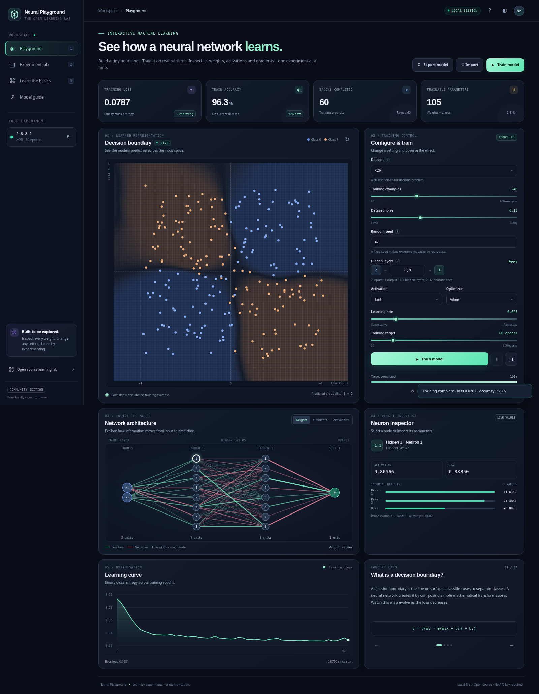

<div align="center">
  
  <h1>Neural Playground</h1>
  <p><strong>Learn by seeing the network learn.</strong></p>
  <p>An interactive, open-source lab for building, training, and inspecting small neural networks—one weight, gradient, and decision boundary at a time.</p>
  <p>
    
    <a href="https://github.com/voyager67/neural-playground/actions/workflows/quality.yml"></a>
    
    
    
  </p>
  <p><a href="#-try-it-now">Try it now</a> · <a href="#-what-you-can-explore">Explore features</a> · <a href="#-learn-the-math">Learn the math</a> · <a href="#-contributing">Contribute</a></p>
</div>



> **A visual-first machine-learning lab.** Train an MLP in your browser, watch its decision boundary change, inspect real neuron activations and parameter gradients, compare optimisers on the same synthetic dataset, and export your experiment. No account, cloud model, or API key required.

## ✨ Why Neural Playground?

Most introductions to neural networks give you equations or a black-box training call. Neural Playground connects the two: change the model, observe the result, then inspect the math that produced it.

- **See learning happen.** Watch a 2D classifier reshape its decision boundary as the loss falls.
- **Open the model.** Click a neuron to inspect its activation, bias, incoming weights, and latest minibatch gradients.
- **Make comparisons.** Run Adam, SGD, Momentum, Tanh, and ReLU against the same data and see the outcomes side by side.
- **Bring the math with you.** A dependency-free browser engine pairs with a NumPy reference implementation and Matplotlib experiment reports.
- **Keep control of your work.** Browser training is local; sessions can persist in local storage and export as JSON or CSV.
- **Learn at your pace.** Concept cards, a model guide, keyboard shortcuts, a responsive layout, and optional offline app-shell caching are built in.

## 🚀 Try it now

### Option A — Use the hosted website

Once GitHub Pages has been enabled for this repository, open the site's URL (usually `https://<your-username>.github.io/<repository-name>/`). The included Pages workflow deploys the static browser application. The Python CLI is not run by GitHub Pages.

### Option B — Run locally

**Requirements for the browser app:** a modern browser and a local static server.

**Windows:** double-click `run_windows.bat`.

**macOS / Linux:**

```bash
chmod +x run_mac_linux.sh
./run_mac_linux.sh
```

The launcher starts a small local HTTP server and opens `http://127.0.0.1:8080`. Keep its terminal open while using the app. Press `Ctrl+C` to stop it.

You can also use Python directly:

```bash
python -m http.server 8080
```

Then open `http://127.0.0.1:8080`.

### Option C — Run the NumPy experiment track

Python 3.10+ is recommended. Create a virtual environment if you prefer to keep dependencies isolated:

```bash
python -m venv .venv
# Windows PowerShell: .venv\Scripts\Activate.ps1
# macOS/Linux: source .venv/bin/activate
python -m pip install -r requirements.txt
python scripts/train_numpy.py --dataset xor --epochs 150 --seed 42
```

The CLI writes a local `outputs/` folder with `experiment.json`, `training-history.csv`, `dataset.csv`, `model.json`, `loss-curve.png`, and `decision-boundary.png`. `outputs/` is ignored by Git.

## 🧪 What you can explore

| Area | What you get |
|---|---|
| **Synthetic datasets** | XOR, concentric circles, two spirals, interleaving moons, and Gaussian blobs; controllable sample count, noise, and seed |
| **Network architecture** | 2D inputs, one to four configurable hidden layers, 2–32 units per hidden layer, and a sigmoid binary output |
| **Training controls** | Train to a target epoch, pause/resume, step one epoch, reset, and resample data |
| **Activation functions** | Tanh, ReLU, Leaky ReLU, and Sigmoid |
| **Optimisers** | SGD, Momentum, and Adam |
| **Live visualisation** | Decision boundary, examples, training loss, train accuracy, epoch count, and parameter count |
| **Network inspector** | Interactive topology, positive/negative weight edges, gradient/activation modes, per-neuron activation, bias, weights, and gradients |
| **Experiment Lab** | Four reference configurations trained on the same dataset, outcome cards, comparison chart, table, and CSV export |
| **Model portability** | JSON model export/import and dataset CSV export |
| **Learning guide** | Concepts, equations, glossary, model contract, optimiser notes, and reproducibility advice |
| **Local-first experience** | Browser local-storage session restore, theme toggle, responsive UI, and service-worker app-shell cache on supported origins |
| **Python track** | NumPy MLP, deterministic datasets, CLI training, metrics, CSVs, Matplotlib loss and boundary plots |

## 🎛️ A good first experiment

1. Choose **XOR** or **Concentric circles**.
2. Start with hidden layers `8,8`, **Tanh**, **Adam**, and learning rate `0.025`.
3. Select **Train model** and observe the boundary and loss chart.
4. Switch the network visualisation from **Weights** to **Gradients** or **Activations**.
5. Click a neuron to inspect its values.
6. Open **Experiment lab** and compare four configurations on the same dataset.
7. Export the model JSON or dataset CSV to inspect the underlying data.

**Keyboard shortcuts:** `1` Playground, `2` Experiment Lab, `3` Learn, `Space` train/pause, `?` quick start, `Esc` close menus.

## 🧠 Learn the math

For each layer, the model computes an affine transformation and then a non-linearity:

\[
z^{(l)} = W^{(l)}a^{(l-1)} + b^{(l)}, \qquad a^{(l)} = \phi(z^{(l)})
\]

For binary classification, the final unit uses a sigmoid probability \(p\). Binary cross-entropy is

\[
\mathcal{L} = -\left[y\log(p) + (1-y)\log(1-p)\right]
\]

With a sigmoid output and binary cross-entropy, the gradient with respect to the output logit simplifies to \(p-y\). Backpropagation applies the chain rule to propagate that signal through hidden layers. The optimiser then uses the gradients to update each weight and bias.

Start with [`docs/CONCEPTS.md`](docs/CONCEPTS.md), then read [`docs/ARCHITECTURE.md`](docs/ARCHITECTURE.md) for implementation details.

## 🔬 Experiment responsibly

- The browser view reports **training** loss and accuracy. These are not held-out generalisation metrics.
- A comparison run is illustrative, not a publication-grade benchmark. Repeat seeds and record uncertainty before making scientific claims.
- The JS and NumPy implementations use their own random-number streams; results need not be numerically identical.
- More parameters do not automatically mean a better model. Watch for overfitting, unstable updates, and poor boundaries.
- All built-in datasets are synthetic. No data is downloaded for training.

See [`docs/RESEARCH_GUIDE.md`](docs/RESEARCH_GUIDE.md) for an experiment template and evaluation checklist.

## 🗂️ Project structure

```text
neural-playground/
├── index.html                 # browser application shell and four learning pages
├── styles.css                 # responsive interface and themes
├── app.js                     # UI, visualisations, training orchestration, exports
├── src/ml-engine.js           # dependency-free JS MLP engine + tests
├── neural_playground/engine.py# NumPy reference engine
├── scripts/train_numpy.py     # reproducible CLI experiment + Matplotlib reports
├── tests/                     # Python tests
├── TEST_REPORT.md             # Recorded local checks and their scope
├── assets/                    # icon, dashboard screenshot, and preview mock-up
├── docs/                      # concepts, architecture, research guide
└── .github/workflows/         # quality checks and GitHub Pages deployment
```

## 🛠️ Development and tests

```bash
# JavaScript syntax and unit tests
npm run check
npm test

# NumPy reference engine and Python CLI
python -m pip install -r requirements.txt
python -m py_compile neural_playground/engine.py scripts/train_numpy.py
python -m unittest discover -s tests -v
```

Continuous integration runs JavaScript and Python checks on pushes and pull requests. See [`TEST_REPORT.md`](TEST_REPORT.md) for checks recorded on this package; verify the live Actions result after uploading the repository. GitHub Pages deployment is a separate workflow; configure **Settings → Pages → Build and deployment → Source: GitHub Actions** for the hosted browser app.

## 🧭 Design principles

1. **Transparent algorithms:** small implementations that readers can follow.
2. **Reproducible experiments:** seeds and configuration are visible and exportable.
3. **Local-first by default:** synthetic data, no analytics beacon, no account service, no remote model API.
4. **Honest evaluation:** distinguish training performance from generalisation and state the limits of a demo.
5. **Friendly to contributions:** tests, documentation, focused issues, and beginner-friendly improvements.

## 🤝 Contributing

First-time contributors are welcome. Improve explanations, add numerical tests, improve accessibility, implement a carefully documented dataset, or make a visualisation more useful. Read [`CONTRIBUTING.md`](CONTRIBUTING.md), follow [`CODE_OF_CONDUCT.md`](CODE_OF_CONDUCT.md), and run the tests before opening a pull request.

If this project helps you learn, teach, or experiment, a GitHub star helps others discover it. Please also share reproducible issues and improvements—not just screenshots of a high training score.

## 📄 License

Released under the MIT License. See [`LICENSE`](LICENSE).

## 🙌 Acknowledgements

Built for learners who want to understand the mechanics behind neural-network training. The screenshot shows the local browser application; all model calculations shown by the running app are computed by the local JavaScript engine.
